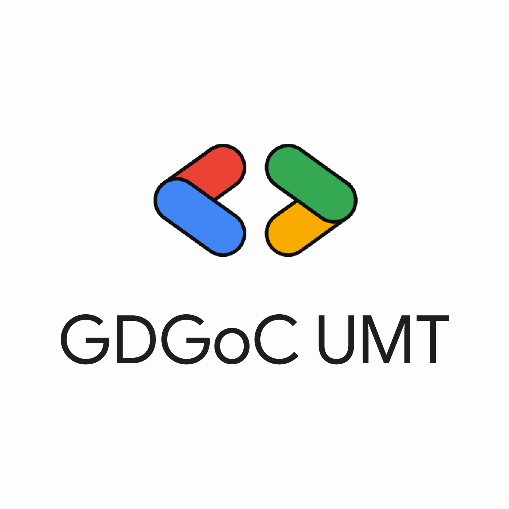

<p align="center">
  
</p>

<h1 align="center">Agentic Engineering in Practice</h1>

<p align="center">
  Demo project for the <a href="https://gdg.community.dev/events/details/google-gdg-on-campus-university-of-management-and-technology-lahore-pakistan-presents-agentic-engineering-in-practice/">GDG on Campus UMT event</a>
</p>

This repository is a small, hands-on example of an AI agent completing a practical task. The agent receives a study-planning goal, uses tools to add tasks, saves the plan as JSON, and reads it back to verify the result.

The demo illustrates how an agent can:

- Break a goal into smaller actions
- Choose and call tools to perform those actions
- Pass tool results back into the conversation
- Save and verify an output

## Requirements

- Python 3.9 or newer
- An [OpenRouter API key](https://openrouter.ai/keys)

## Setup

Clone the repository and move into its directory:

```bash
git clone <repository-url>
cd <repository-directory>
```

Create and activate a virtual environment (recommended):

```bash
python3 -m venv .venv
source .venv/bin/activate
```

On Windows PowerShell:

```powershell
py -m venv .venv
.venv\Scripts\Activate.ps1
```

Install the required packages:

```bash
python -m pip install openai python-dotenv
```

Create a `.env` file in the project directory and add your OpenRouter key:

```dotenv
OPENROUTER_API_KEY=your_openrouter_api_key
```

Keep your API key private. Do not commit your `.env` file.

## Run the demo

```bash
python agent_demo.py
```

Enter a goal when prompted. Press Enter to use the built-in example, which creates a three-hour study plan. The agent prints its tool calls and writes the plan to `study_plan.json` in the current directory.

## Project files

- `agent_demo.py` — agent loop, tool definitions, and study-planning functions
- `assets/gdgoc-umt-logo.png` — GDG on Campus UMT logo used in this README
- `study_plan.json` — generated when the agent saves a plan

## Troubleshooting

- If you see `OPENROUTER_API_KEY is not set`, check that `.env` is in the project directory and that the variable name is spelled exactly as shown.
- If Python cannot import `openai` or `dotenv`, activate the virtual environment and install the packages again.

## Event and community

- [Agentic Engineering in Practice event](https://gdg.community.dev/events/details/google-gdg-on-campus-university-of-management-and-technology-lahore-pakistan-presents-agentic-engineering-in-practice/)
- [GDG on Campus UMT chapter](https://gdg.community.dev/gdg-on-campus-university-of-management-and-technology-lahore-pakistan/)
